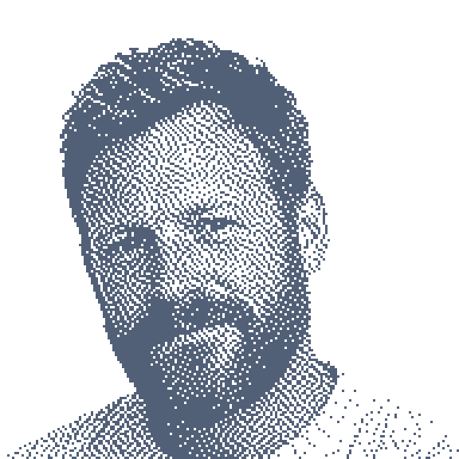
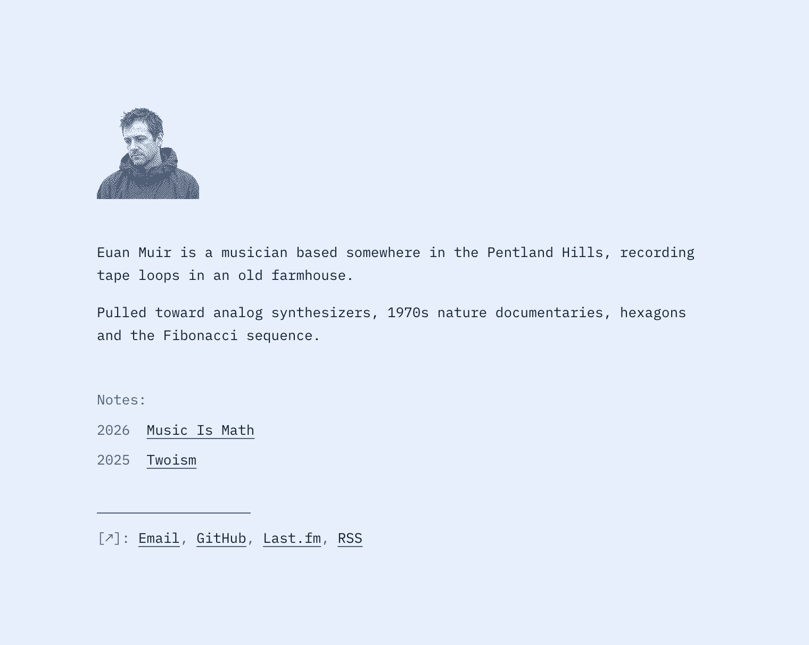
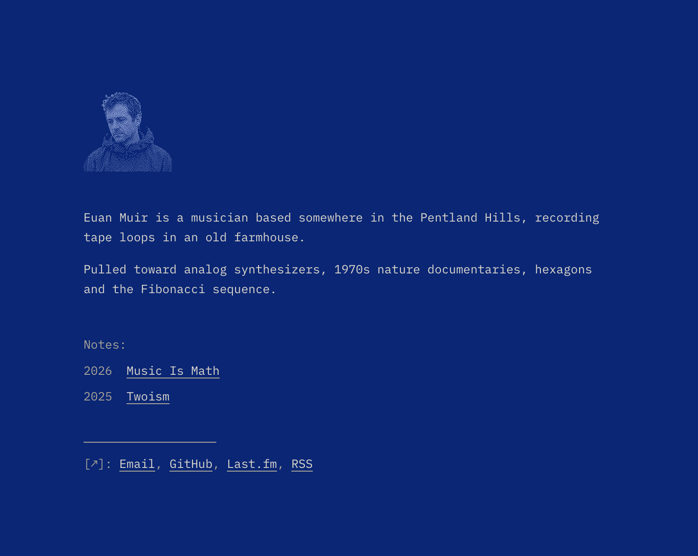
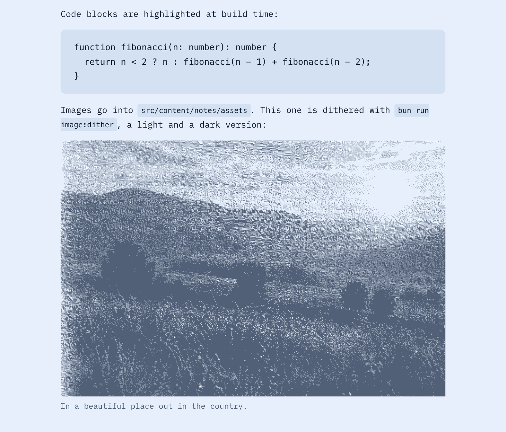
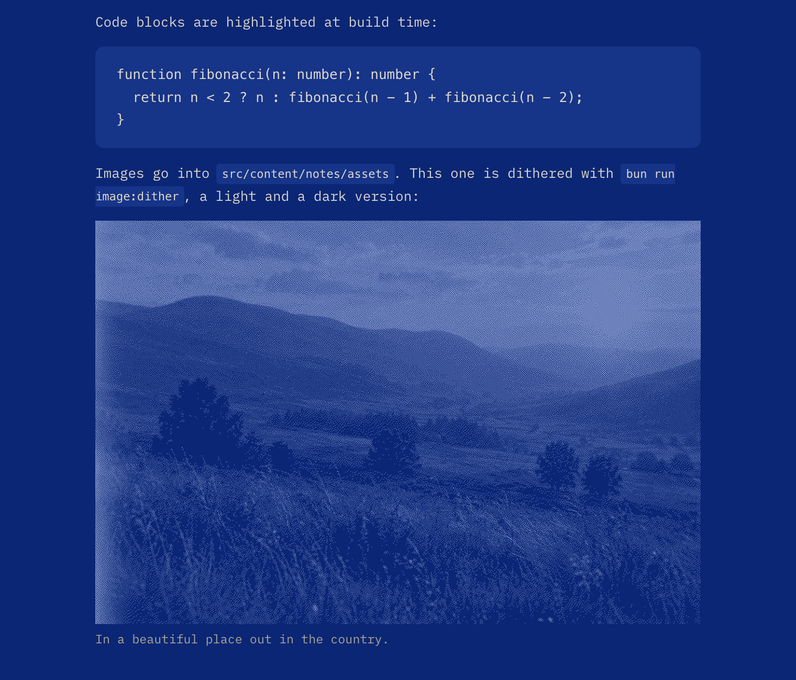

<picture>
  <source srcset="public/portrait-dark.webp" media="(prefers-color-scheme: dark)">
  
</picture>

# Twoism

An Astro template for a short intro and a list of notes. Named after the 1995 Boards of Canada EP.

| Light | Dark |
| --- | --- |
|  |  |
|  |  |

```sh
bun create astro@latest --template esafev/twoism
bun run dev
```

Your name, links and site URL live in `src/consts.ts`, the intro in `src/content/intro.mdx`, notes in `src/content/notes`.

```sh
bun run note:create "Title" "Description"   # draft note
bun run portrait:create photo.jpg           # dithered portrait, macOS
bun run image:dither photo.jpg              # dithered image for a note
```

MIT. IBM Plex Mono is under the OFL. The portrait is a fictional person, generated with AI.
